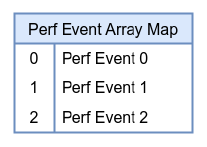
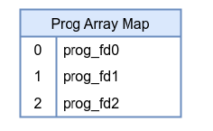
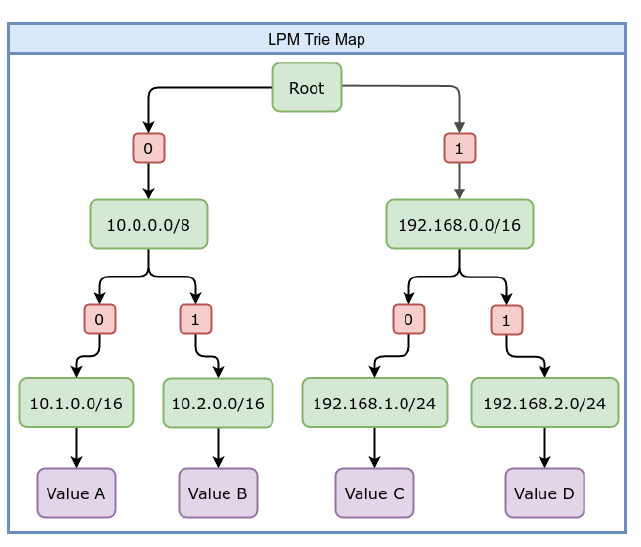
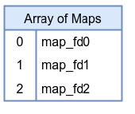
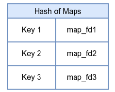
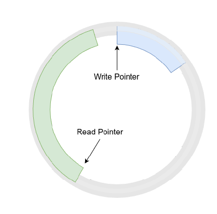

источник [Engineer_everything_with_eBPF](_sources/Engineer_everything_with_eBPF.md)
## В user-space
Карты создаются (выделение памяти и связывание с eBPF программой) и управляются через системный вызов `bpf(BPF_MAP_CREATE, ...)` . или его обёртку `bpf_map_create()`

## В kernel-space
Объявляется сама структура карты (тип самой карты, размер ключа, размер значения, другие парамтеры)
## В коде
С точки зрения программиста, eBPF карты представлены как файловые дескрипторы (интересно, можно ли делать read, write ?)
# Hash-Map
Сохраняет пары ключ-значения.
В качестве ключа можно использовать PID или IP адрес, например
[BTF](BTF.md) определение выглядит так
```c
struct {
	__uint(type, BPF_MAP_TYPE_HASH);
	__type(key, int);
	__type(value, int);
	__uint(max_entries, 1024);
} hash_map_example SEC(".maps");
```


Создавать с флагом `BPF_MAP_TYPE_ARRAY`
# Array-Map
Обычный массив

```c
struct {
	__uint(type, BPF_MAP_TYPE_ARRAY);
	__type(key, int);
	__type(value, int);
	__uint(max_entries, 256);
} array_map_example SEC(".maps");
```

# Perf-Event-Array-Map
Это механизм, как можно пожключиться к кольцевому буферу событий perf'а. (hardware, software события)



[[BTF]] определение
```c
struct {
	__uint(type, BPF_MAP_TYPE_PERF_EVENT_ARRAY);
	__type(key, int);
	__type(value, int);
	__uint(max_entries, 64); // will be set to the number of CPU
} perf_event_array_example SEC(".maps");
```

# Prog-Array-Map


Позволяет совершать [eBPF-tail-calls](eBPF-tail-calls.md). 

# PERCPU-Hash-Map

То же, что и [Hash-Map](#Hash-Map), но хранится локально для каждого ядра.  
[[BTF]] объявление
```c
struct {
	__uint(type, BPF_MAP_TYPE_PERCPU_HASH);
	__type(key, int);
	__type(value, int);
	__uint(max_entries, 1024);
} percpu_hash_example SEC(".maps");
```

# PERCPU-Array-Map
То же, что и [Array-Map](#Array-Map), но для каждого ядра.

[BTF](BTF.md) объявление:
```c
 struct {
	 __uint(type, BPF_MAP_TYPE_PERCPU_ARRAY);
	 __type(key, int);
	 __type(value, int);
	 __uint(max_entries, 1024);
 } percpu_array_example SEC(".maps");
```

# LMP-Trie-Map
Longest Prefix Match. Как пример, можем запомнить префикс IP адресов, чтобы распределить IP по сети

> When creating an LPM Trie map, it is important to use the `BPF_F_NO_PRE-ALLOC` flag. This flag prevents the kernel from pre-allocating memory for all entries at map creation time, allowing the map to dynamically allocate memory as needed.



```c
struct {
	 __uint(type, BPF_MAP_TYPE_LPM_TRIE);
	 __type(key, int);
	 __type(value, int);
	 __uint(max_entries, 1024);
 } lpm_trie_example SEC(".maps");
```

# Array-of-Maps-Map

# Hash-of-Maps-Map


# Ring-Buffer-Map
Кольцевой буфер общий для всех процессов. eBPF программа пишет, а пользовательское приложение читает. 

-